# Cómo usar este documento

Este documento reúne todo el contenido de la web, sección por sección. Cada sección trae cinco piezas. El texto que se lee en pantalla, las definiciones que conviene destacar en un recuadro, los datos clave, los gráficos y un guion visual que indica qué ilustración o ícono va entre los textos y cómo animar cada gráfico al hacer scroll.

Los gráficos están en la carpeta `graficos/` en PNG y SVG. Son una referencia del mensaje que debe transmitir cada uno, no el diseño final. Los datos con que se hicieron están en `datos/` en formato CSV, para que puedan rehacerse como gráficos animados.

Ninguna cifra es inventada. Cuando un número viene de un cálculo propio, se indica.

---

# Sistema visual general

La web de referencia (natalidad-chile.netlify.app) funciona con muy pocos recursos que se repiten. Una ilustración pequeña que se multiplica en la portada (las cigüeñas), un gráfico que queda fijo en pantalla mientras el texto avanza y va marcando hitos con el formato "año · cifra", pictogramas del tipo "si Chile fueran 100 personas" y una secuencia de ilustraciones simples para explicar una cadena de causas. Esta web puede seguir la misma gramática con elementos propios del clima.

**Ilustraciones.** Íconos de línea simple, de un solo grosor, en dos colores como máximo. Un azul para lo frío, lo natural y la evidencia, y un rojo para el calor, lo humano y lo actual. Los elementos que se repiten a lo largo de la web son un cubo de hielo, una burbuja de aire, una chimenea, un volcán, un sol, un termómetro, una ola y un mapa de Chile.

**El patrón de scroll.** En cada gráfico principal, el gráfico queda fijo y el texto pasa por encima en tarjetas cortas. Cada tarjeta enciende una parte del gráfico. La tarjeta lleva arriba el hito en formato "1959 · 316 ppm" y abajo una frase de una línea, tal como en la web de natalidad.

**Las definiciones.** Cada término técnico aparece la primera vez con un subrayado punteado. Al tocarlo se abre un recuadro con la definición. Las definiciones más importantes (clima, tiempo, efecto invernadero) aparecen además como recuadros fijos en el texto.

**Accesibilidad.** Toda animación debe tener una versión estática para quien tenga activada la opción de reducir movimiento, y cada gráfico debe poder leerse sin animación.

---

# 0. Portada

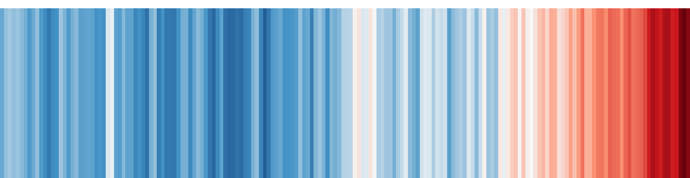

**Título.** El clima siempre ha cambiado. ¿Entonces?

**Bajada.** Una guía para quien todavía no está convencido.

**Texto.**

Si llegaste a esta página, lo más probable es que tengas dudas. Quizás has escuchado que el clima de la Tierra siempre ha cambiado, que hubo glaciaciones mucho antes de que existieran los autos, o que todo esto es una exageración. Son dudas razonables. La ciencia avanza justamente porque alguien duda.

Aquí no te vamos a pedir que creas nada. Vamos a revisar la evidencia en el orden en que lo haría un científico escéptico, una pregunta a la vez, con los datos originales y sus fuentes a la vista. Al final, la conclusión la sacas tú.

**Guion visual.**

La imagen de portada son las franjas de calentamiento. Cada franja vertical es un año entre 1850 y 2025, y el color va de azul (año más frío) a rojo (año más cálido). Al cargar la página, las franjas aparecen una por una de izquierda a derecha, en unos tres segundos, y el rojo final queda como golpe visual. Bajo las franjas va una leyenda mínima, con "1850" a la izquierda, "2025" a la derecha y la frase "cada franja es un año".

Como equivalente de las cigüeñas, la portada puede llevar una fila de pequeños cubos de hielo dibujados en línea que, al hacer scroll, se van derritiendo hasta quedar como gotas.

**Fuente de los datos.** NOAA NCEI. Método de franjas de Ed Hawkins, Universidad de Reading.

---

# 1. Sí, el clima siempre ha cambiado

**Bajada.** Y justamente por eso sabemos que lo de ahora es distinto.

**Texto.**

Empecemos dándole la razón al argumento más común. El clima de la Tierra ha cambiado muchas veces. Hubo glaciaciones en las que enormes capas de hielo cubrían buena parte de Norteamérica y Europa, y hubo periodos más cálidos. Nadie en la ciencia del clima discute eso. De hecho, gran parte de lo que sabemos sobre el cambio climático actual viene de estudiar esos cambios del pasado.

Pero antes de seguir, conviene ponernos de acuerdo en qué significa "clima".

> **¿Qué es el clima?** Es el tiempo promedio de un lugar, o de todo el planeta, durante un periodo largo. La Organización Meteorológica Mundial usa como periodo clásico 30 años.
>
> **¿Y el tiempo?** Es lo que pasa hoy o esta semana. Si llueve, si hace frío, si hay viento. El tiempo puede cambiar en horas. El clima cambia en décadas.
>
> Una forma sencilla de recordarlo es que el tiempo es tu ánimo de hoy y el clima es tu personalidad.
>
> *Definición adaptada del Glosario del IPCC, Sexto Informe de Evaluación.*

Volvamos al pasado. ¿Cómo se sabe qué clima había hace cientos de miles de años, si nadie estaba ahí para medirlo? Con hielo. En la Antártida, la nieve se acumula año tras año y va atrapando pequeñas burbujas de aire. Esas burbujas son muestras de la atmósfera de su época. Al perforar el hielo y sacar cilindros de varios kilómetros de largo, los científicos pueden medir cuánto CO₂ había en cada momento.

> **¿Qué es un núcleo de hielo?** Es un cilindro de hielo extraído de un glaciar o de una capa de hielo, que se usa para estudiar el clima y la composición de la atmósfera del pasado, conservada en el hielo y en el aire atrapado en él.
>
> *Adaptado del Glosario del IPCC.*

> **¿Qué significa ppm?** Partes por millón. Si decimos que hay 427 ppm de CO₂, significa que de cada millón de moléculas de aire, 427 son de CO₂.

Lo que muestran esos registros es un ritmo bastante ordenado. Durante los últimos 800.000 años el CO₂ subió y bajó siguiendo los ciclos de las glaciaciones. En las épocas frías bajaba y en las cálidas subía, pero siempre se mantuvo entre unas 174 y unas 299 ppm. Nunca pasó de ese techo.

Hoy estamos en 427 ppm.

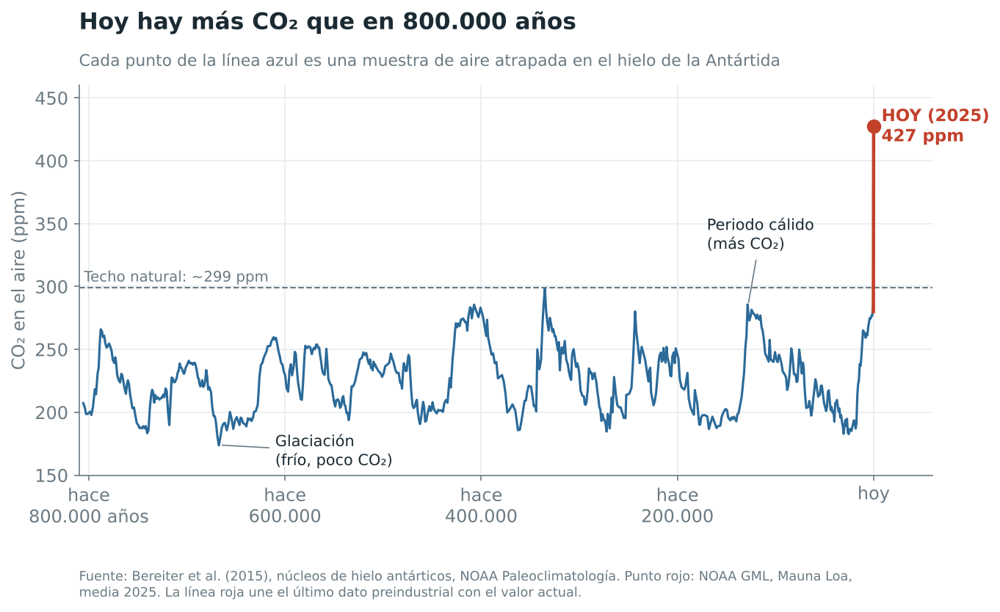

**Cómo leer este gráfico.** El eje horizontal es el tiempo. A la izquierda está el pasado lejano, hace 800.000 años, y a la derecha está hoy. Cada subida de la línea azul corresponde a un periodo cálido y cada bajada a una glaciación. La línea punteada marca el techo natural. El punto rojo es el valor medido en 2025, y la línea roja vertical muestra el salto de los últimos 270 años, que a esta escala parece instantáneo.

Hay un segundo dato que importa tanto como el primero, y es la velocidad. Hace unos 20.000 años, en lo más frío de la última glaciación, el planeta era en promedio unos 6 °C más frío que hoy. Salir de esa glaciación tomó alrededor de diez mil años. Si hacemos la cuenta gruesa, eso es del orden de 0,06 °C por siglo.

El calentamiento actual avanza a 0,27 °C por década, unos 2,7 °C por siglo si se mantuviera el ritmo. Eso es del orden de cuarenta veces más rápido que la salida natural de una glaciación.

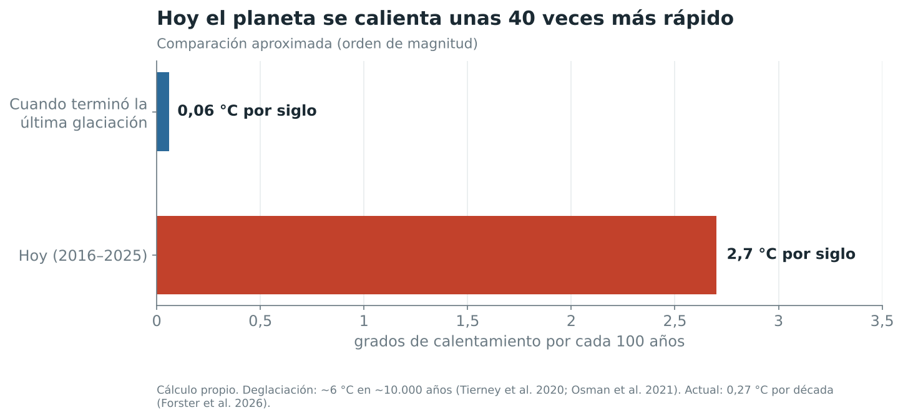

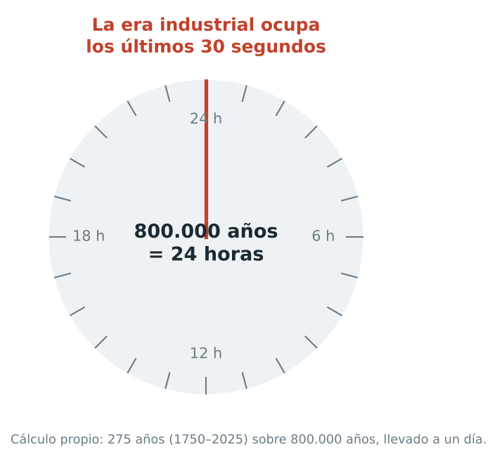

El IPCC, el organismo de Naciones Unidas que evalúa la ciencia del clima, llega a la misma conclusión por otra vía. Según su último informe, la temperatura ha subido desde 1970 más rápido que en cualquier otro periodo de 50 años de, al menos, los últimos 2.000 años, y el CO₂ está en su nivel más alto de los últimos dos millones de años como mínimo.

> **¿Qué es el IPCC?** El Grupo Intergubernamental de Expertos sobre el Cambio Climático, creado en 1988 por Naciones Unidas y la Organización Meteorológica Mundial. No hace investigación propia. Reúne y evalúa miles de estudios publicados, y sus informes son revisados por científicos y gobiernos de todo el mundo.

Que el clima haya cambiado antes por causas naturales no prueba que el cambio actual también lo sea. Pasa lo mismo con los incendios forestales. Que existan incendios provocados por rayos no significa que ningún incendio sea intencional. En cada caso hay que investigar la causa, y eso es lo que haremos en las siguientes secciones.

**Datos clave.** Entre 174 y 299 ppm de CO₂ durante 800.000 años. 427 ppm en 2025. Calentamiento actual del orden de 40 veces más rápido que al salir de la última glaciación.

**Guion visual.**

Entre el primer y el segundo párrafo va una ilustración simple de un cilindro de hielo cortado, con pequeñas burbujas dentro. Al hacer scroll, una burbuja se desprende y sube hasta convertirse en el primer punto del gráfico. Es el paso del objeto al dato.

El gráfico de 800.000 años se anima en cuatro pasos fijos mientras el texto avanza. En el primer paso, la línea azul se dibuja de izquierda a derecha, con la tarjeta "Hace 800.000 años · 800 mil años de datos en el hielo". En el segundo, se sombrean en celeste las bajadas, con la tarjeta "Glaciaciones · el CO₂ baja a unos 180 ppm". En el tercero aparece la línea punteada del techo natural, con la tarjeta "Techo natural · nunca más de 299 ppm". En el cuarto, la línea roja sube de golpe hasta el punto de 2025, con la tarjeta "2025 · 427 ppm".

Después viene el reloj. Es un reloj de 24 horas que representa los 800.000 años. La aguja recorre el día completo y al llegar a medianoche se detiene, con el texto "la era industrial ocupa los últimos 30 segundos" (cálculo propio, 275 años sobre 800.000 años). Funciona como el equivalente de "si Chile fueran 100 personas".

El gráfico de velocidad se anima con las dos barras creciendo al mismo tiempo. La azul se detiene casi de inmediato y la roja sigue creciendo.

**Fuentes.** Bereiter et al. (2015), núcleos de hielo antárticos, NOAA Paleoclimatología. NOAA GML, Mauna Loa. Tierney et al. (2020), *Nature*. Osman et al. (2021), *Nature*. Forster et al. (2026), *Earth System Science Data*. IPCC AR6 GTI, Resumen para responsables de políticas, A.2.1 y A.2.2. Glosario del IPCC AR6.

**Nota metodológica.** Los 0,06 °C por siglo son una aproximación propia y sirven para comparar órdenes de magnitud. Durante la deglaciación hubo tramos más rápidos y otros más lentos. En la web conviene presentarlo así, como orden de magnitud.

---

# 2. ¿Se está calentando el planeta ahora?

**Bajada.** Lo primero es comprobar que hay algo que explicar.

**Texto.**

Desde fines del siglo XIX existen mediciones de temperatura en estaciones en tierra, en barcos y, más tarde, en boyas en el océano. Varias instituciones combinan esos datos para calcular la temperatura media del planeta, y lo hacen por separado. Entre ellas están NOAA y NASA en Estados Unidos, el servicio Copernicus de la Unión Europea, la Oficina Meteorológica del Reino Unido y la Agencia Meteorológica de Japón.

Cada una usa métodos algo distintos, así que sus cifras no son idénticas. Lo interesante es que todas dibujan la misma curva.

> **¿Qué es una anomalía de temperatura?** Es la diferencia entre la temperatura de un año y el promedio de un periodo de referencia. Si un año tiene una anomalía de +1 °C, significa que estuvo un grado más cálido que ese promedio. Se usa porque es más fácil comparar diferencias que temperaturas absolutas de lugares muy distintos.
>
> *Adaptado del Glosario del IPCC.*

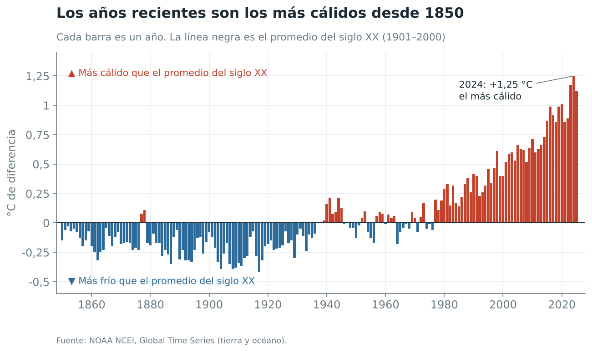

**Cómo leer este gráfico.** Cada barra es un año. La línea negra horizontal es el promedio del siglo XX. Las barras azules son años más fríos que ese promedio y las rojas, años más cálidos.

Los años suben y bajan porque fenómenos como El Niño y La Niña calientan o enfrían el planeta por un tiempo. Pero la tendencia de fondo no deja dudas. En la serie de NOAA, los once años más cálidos desde 1850 son los once años que van de 2015 a 2025, y el más cálido de todos fue 2024.

> **¿Qué son El Niño y La Niña?** Son fases de un fenómeno natural del océano Pacífico tropical que se repite cada pocos años. Con El Niño el planeta suele calentarse un poco durante uno o dos años, y con La Niña suele enfriarse levemente. Explican los altibajos de un año a otro, pero no la tendencia de largo plazo.

> **¿Qué es el nivel preindustrial?** Es el periodo anterior al inicio de la actividad industrial a gran escala, hacia 1750. Como no hay suficientes termómetros de esa época, para la temperatura se usa como referencia el promedio de 1850 a 1900.
>
> *Adaptado del Glosario del IPCC.*

Según Copernicus, 2025 estuvo 1,47 °C por encima del nivel preindustrial y fue el tercer año más cálido registrado. El promedio de 2023, 2024 y 2025 superó por primera vez 1,5 °C. Septiembre de 2026 marcó 1,63 °C, con un El Niño en fortalecimiento.

Un detalle a favor de la duda. Como cada institución compara con un periodo distinto, el valor de un mismo año cambia según la fuente. El gráfico de NOAA compara con el promedio del siglo XX y Copernicus compara con 1850 a 1900. Por eso las cifras no calzan exactamente, aunque todas muestren lo mismo.

**Datos clave.** Los 11 años más cálidos son los de 2015 a 2025. 2025 a 1,47 °C sobre el nivel preindustrial. 2023 a 2025, primer trienio sobre 1,5 °C.

**Guion visual.**

La transición desde la portada es el momento más potente de esta sección. Las franjas de color se estiran hacia arriba o hacia abajo según su valor y se convierten en las barras del gráfico. El lector entiende sin explicación que el color era la temperatura.

Tarjetas del scroll, siguiendo el formato de natalidad. "1880 · −0,19 °C", con la frase "Así empieza el registro". "1976 · −0,06 °C", con la frase "Todavía cerca del promedio del siglo XX". "2024 · +1,25 °C", con la frase "El año más cálido medido".

Entre el texto y el gráfico va un ícono de termómetro y, al lado, un ícono de nube con sol, para separar visualmente "clima" de "tiempo" en el recuadro de definiciones.

**Fuentes.** NOAA NCEI, Global Time Series. Copernicus C3S, Global Climate Highlights 2025 y boletín de septiembre de 2026. Glosario del IPCC AR6.

---

# 3. ¿Qué cambió en la atmósfera?

**Bajada.** La medición más constante de la historia de la ciencia.

**Texto.**

En 1958, el científico Charles David Keeling empezó a medir el CO₂ del aire en el observatorio de Mauna Loa, en Hawái, a más de 3.000 metros de altura y lejos de ciudades y fábricas. Desde 1974, NOAA hace su propia medición en paralelo. El resultado se conoce como curva de Keeling y es el registro directo de CO₂ más largo que existe.

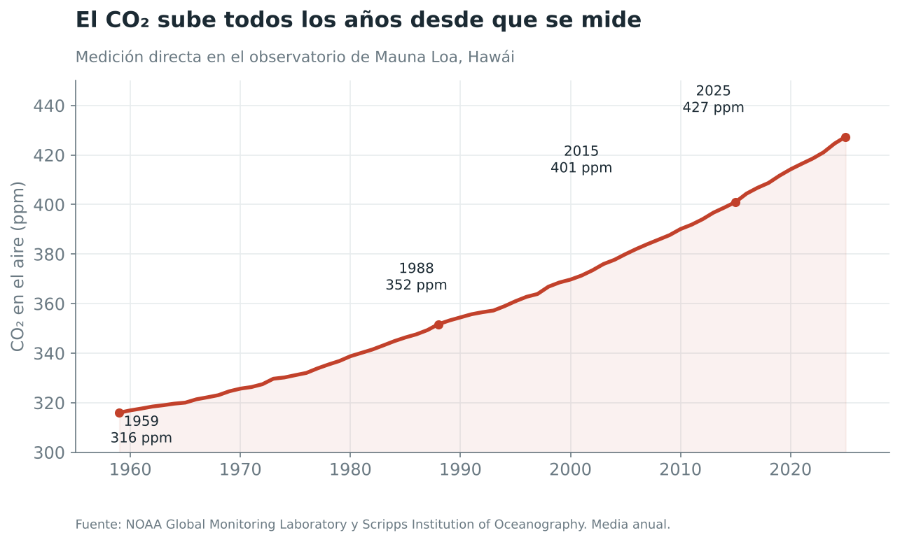

La concentración pasó de 316 ppm en 1959 a 427 ppm en 2025, y el promedio anual no ha bajado ni un solo año. El ritmo, además, se acelera. Según la Oficina Meteorológica británica, el CO₂ aumentaba en promedio 0,86 ppm por año en la década de 1960 y 2,41 ppm por año en la de 2010. El salto entre 2023 y 2024 fue el mayor de todo el registro.

El CO₂ no es el único gas que creció. El IPCC estima que, desde 1750, el CO₂ aumentó un 47% y el metano un 156%.

Ahora bien, 427 ppm suena a muy poco. Y lo es.

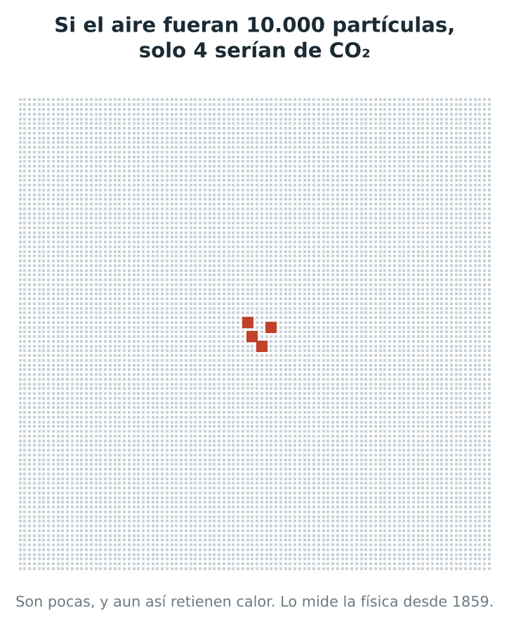

> **¿Qué es el efecto invernadero?** Algunos gases del aire, como el vapor de agua, el CO₂ y el metano, absorben parte del calor que la Tierra emite hacia el espacio y lo devuelven en todas direcciones, también hacia la superficie. Sin ese efecto natural el planeta sería mucho más frío. El problema aparece cuando aumentan esos gases, porque el efecto se intensifica y la superficie se calienta más.
>
> *Adaptado del Glosario del IPCC.*

> **¿Qué es un gas de efecto invernadero?** Es un gas que absorbe y emite radiación infrarroja, es decir, calor. Los principales son el vapor de agua, el CO₂, el metano, el óxido nitroso y el ozono.

**Datos clave.** De 316 a 427 ppm en 66 años. En 1988 se cruzaron las 350 ppm y en 2015 las 400 ppm.

**Guion visual.**

Antes del gráfico va una ilustración de línea del volcán Mauna Loa con un pequeño observatorio en la cima. Del observatorio sale una línea que se convierte en la curva.

Tarjetas del scroll. "1959 · 316 ppm", con la frase "Keeling hace su primera medición anual completa". "1988 · 350 ppm". "2015 · 400 ppm". "2025 · 427 ppm", con la frase "Ni un solo año de baja".

Después viene el pictograma de las 10.000 partículas, el equivalente directo de "si Chile fueran 100 personas". Se muestra una grilla de 100 por 100 puntos grises. Al hacer scroll, cuatro de ellos se encienden en rojo. Una segunda versión de la grilla puede mostrar cuántos había antes de la era industrial, unos 2,8 de cada 10.000 (cálculo propio, a partir del aumento de 47% que informa el IPCC).

Para la definición de efecto invernadero se sugiere un diagrama de tres capas, con el Sol arriba, una banda de gases al medio y la Tierra abajo. Las flechas amarillas entran desde el Sol, las rojas salen desde la Tierra, y parte de las rojas rebotan en la banda de gases y vuelven a bajar. Al hacer scroll, la banda se engrosa y rebotan más flechas.

**Fuentes.** NOAA GML y Scripps Institution of Oceanography. Met Office, pronóstico de CO₂ en Mauna Loa para 2025. IPCC AR6 GTI, A.2.1. Glosario del IPCC AR6.

---

# 4. ¿Cómo sabemos que ese CO₂ es nuestro?

**Bajada.** Tres pistas independientes que apuntan al mismo lugar.

**Texto.**

La primera pista es una cuenta. Cada año la humanidad quema carbón, petróleo y gas, y las estadísticas de producción y consumo de energía permiten calcular cuánto CO₂ libera eso. Según el Global Carbon Project, las emisiones fósiles de 2025 llegaron a 38.100 millones de toneladas, un nuevo récord.

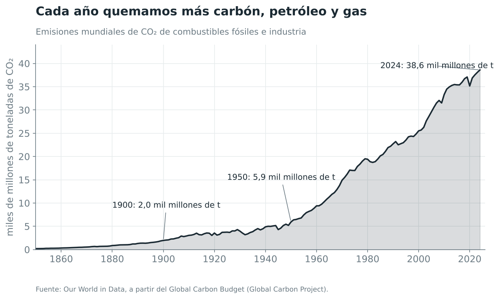

La segunda pista es química. El carbono existe en versiones más livianas y más pesadas, llamadas isótopos. Las plantas prefieren el carbono liviano (carbono‑12) al pesado (carbono‑13). El carbón, el petróleo y el gas son restos de plantas de hace millones de años, así que su CO₂ trae poco carbono‑13. Si el CO₂ extra del aire viniera de los combustibles fósiles, la proporción de carbono‑13 en la atmósfera debería bajar. Y eso es exactamente lo que se mide. Los volcanes no dejan esa firma.

> **¿Qué es un isótopo?** Es una variante de un mismo elemento químico que pesa un poco más o un poco menos. El carbono‑12 y el carbono‑13 son el mismo carbono, pero el segundo tiene un neutrón más. Esa pequeña diferencia funciona como una etiqueta de origen.

La tercera pista descarta la explicación que más circula en redes. Los volcanes emiten entre 0,3 y 0,6 mil millones de toneladas de CO₂ al año, según los estudios de Gerlach (2011) y Burton y colegas (2013). Las actividades humanas emiten 60 veces más, o incluso más.

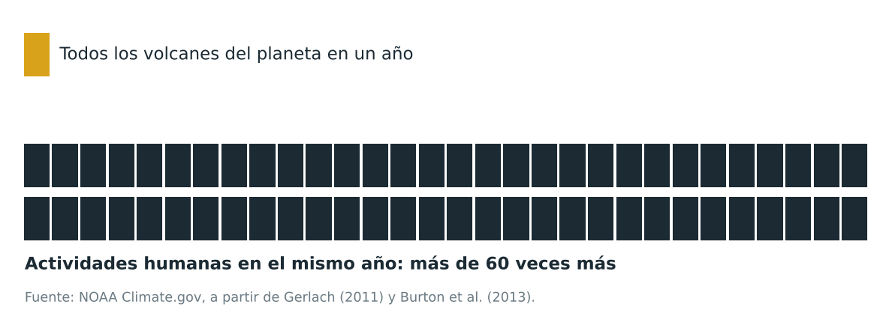

**Datos clave.** 38.100 millones de toneladas de CO₂ fósil en 2025. Por cada tonelada que emiten todos los volcanes del planeta, la humanidad emite más de 60.

**Guion visual.**

Esta sección imita la secuencia de causas de la web de natalidad, que usa una ilustración por paso. Aquí son tres ilustraciones que se suceden con el scroll, cada una con su pista. La primera es una calculadora o una factura de energía, para "la cuenta". La segunda es una lupa sobre dos átomos de distinto tamaño, para "la huella química". La tercera es una balanza con un volcán en un plato y una chimenea en el otro, para "los volcanes".

La balanza se convierte luego en el pictograma de bloques. Primero aparece un bloque amarillo (los volcanes) y luego caen, uno tras otro, 60 bloques oscuros (las personas). La caída de bloques dura unos dos segundos.

El gráfico de emisiones se dibuja de izquierda a derecha con tres tarjetas. "1900 · 2 mil millones de toneladas". "1950 · 6 mil millones". "2024 · 38,6 mil millones".

**Fuentes.** Global Carbon Project, Global Carbon Budget 2025. Our World in Data, base de datos de CO₂. NOAA GML, isótopos estables. Graven et al. (2020), *Global Biogeochemical Cycles*. NOAA Climate.gov, volcanes y emisiones humanas.

---

# 5. ¿Y si fuera el Sol?

**Bajada.** La sospecha más lógica, y la que mejor se puede comprobar.

**Texto.**

Es razonable pensar en el Sol, porque de ahí viene casi toda la energía que mueve el clima. Hace décadas que se mide con satélites cuánta energía llega del Sol, y con registros más antiguos se ha reconstruido hacia atrás. Si el Sol fuera el responsable del calentamiento, su energía debería haber aumentado a la par con la temperatura.

> **¿Qué es la irradiancia solar?** Es la cantidad de energía del Sol que llega a la parte alta de la atmósfera, medida en vatios por metro cuadrado (W/m²). Varía un poco con un ciclo de unos 11 años.

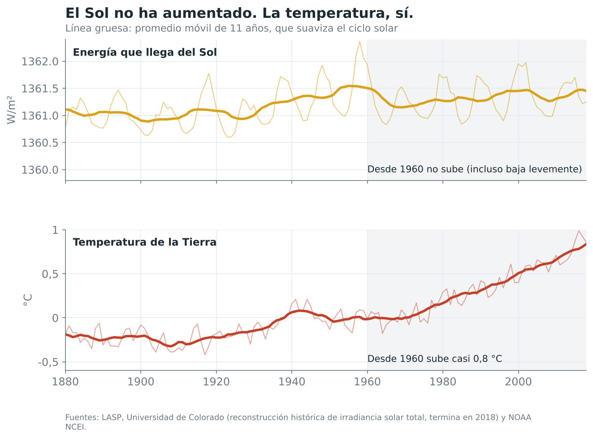

**Cómo leer este gráfico.** Arriba está el Sol y abajo la temperatura, en el mismo periodo. La línea delgada muestra cada año y la gruesa suaviza los altibajos. La zona gris marca desde 1960 en adelante.

La energía del Sol oscila con su ciclo, pero no tiene una tendencia al alza. En la reconstrucción del LASP, el promedio entre 1955 y 1965 fue de 1.361,50 W/m², y entre 2008 y 2018 fue de 1.361,36 W/m². Bajó un poco. En ese mismo lapso la temperatura global subió cerca de 0,8 °C.

Hay además una prueba más fina, que funciona como una huella digital. Si el Sol calentara más, toda la atmósfera se calentaría, incluidas sus capas altas. Si la causa son los gases de efecto invernadero, que retienen el calor cerca de la superficie, la capa baja se calienta y la capa alta se enfría.

> **Troposfera y estratosfera.** La troposfera es la capa más baja de la atmósfera, donde están las nubes y ocurre el tiempo. Encima está la estratosfera, que llega hasta unos 50 kilómetros de altura.
>
> *Adaptado del Glosario del IPCC.*

Un estudio publicado en 2023 en la revista PNAS, liderado por Benjamin Santer, encontró que la estratosfera media y alta se enfrió entre 1,8 y 2,2 °C entre 1986 y 2022. Ese cambio es entre 12 y 15 veces mayor que el que podrían explicar las causas naturales.

**Datos clave.** Según el IPCC, el efecto sumado del Sol y los volcanes sobre la temperatura, entre 1850–1900 y 2010–2019, está entre −0,1 y +0,1 °C. Del calentamiento observado de 1,09 °C, la mejor estimación de la parte causada por el ser humano es 1,07 °C.

**Guion visual.**

Un ícono de sol abre la sección. El gráfico doble se dibuja primero en su panel superior (el Sol) y la tarjeta dice "El Sol sube y baja, pero no sube". Luego se dibuja el panel inferior (la temperatura) con la tarjeta "La Tierra sí sube". Al final se sombrea la zona desde 1960 en ambos paneles a la vez.

Para la huella de la estratosfera se sugiere un corte vertical de la atmósfera en dos franjas. La de abajo (troposfera) se tiñe de rojo y la de arriba (estratosfera) se tiñe de azul. A un costado, dos mini escenas comparan qué pasaría si fuera el Sol (las dos franjas en rojo) con lo que se observa (abajo rojo, arriba azul). Es un diagrama sencillo que explica una idea difícil.

**Fuentes.** LASP, Universidad de Colorado, reconstrucción histórica de irradiancia solar total. NOAA NCEI. Santer et al. (2023), *PNAS*. IPCC AR6 GTI, A.1.3. Glosario del IPCC AR6.

**Nota para el desarrollo.** La serie solar del LASP termina en 2018. No conviene empalmarla con la serie satelital más reciente, porque ambas tienen una diferencia de calibración que crearía un salto falso.

---

# 6. ¿Es una idea nueva?

**Bajada.** La física del efecto invernadero tiene 170 años.

**Texto.**

Mucha gente asume que el cambio climático es una teoría reciente, nacida junto con el debate político. En realidad se conoce desde mediados del siglo XIX y se ha comprobado en laboratorio muchas veces.

En 1856, la científica estadounidense Eunice Foote expuso al sol cilindros de vidrio con distintos gases y notó que el que tenía CO₂ se calentaba más. Sugirió entonces que una atmósfera con más CO₂ haría más cálido al planeta.

En 1859, John Tyndall, en Londres, midió con precisión cómo el vapor de agua y el CO₂ absorben radiación infrarroja, que es el calor que la Tierra devuelve al espacio.

En 1896, el sueco Svante Arrhenius calculó por primera vez cuánto se calentaría el planeta si se duplicara el CO₂ del aire.

En 1958, Keeling comenzó a medir el CO₂ en Mauna Loa y confirmó que aumentaba año tras año.

El razonamiento completo cabe en tres líneas. Hace 170 años que sabemos que el CO₂ retiene calor. Desde 1750 su concentración aumentó casi a la mitad. Y el planeta se calentó. Lo raro sería que no lo hubiera hecho.

**Guion visual.**

Una línea de tiempo horizontal que se recorre con el scroll, con cuatro hitos. Cada hito lleva un ícono de línea en lugar de retratos. Dos cilindros de vidrio al sol para Foote, un rayo que atraviesa un tubo para Tyndall, una hoja con un cálculo para Arrhenius y el observatorio de Mauna Loa para Keeling. Al llegar al último hito, la línea de tiempo se une con la curva de Keeling de la sección 3, para mostrar que la historia continúa.

**Fuentes.** Foote (1856), *American Journal of Science*. Tyndall (1861), *Philosophical Transactions of the Royal Society*. Arrhenius (1896), *Philosophical Magazine*. Weart, *The Discovery of Global Warming*, American Institute of Physics.

---

# 7. ¿Hay otras señales además del termómetro?

**Bajada.** El hielo, el mar y el océano cuentan la misma historia.

**Texto.**

Supongamos que los termómetros estuvieran mal calibrados, o que las ciudades crecieron alrededor de las estaciones y las calientan artificialmente. Si fuera así, el resto del sistema climático no debería mostrar cambios. Pero el hielo del Ártico, el nivel del mar y el calor del océano se miden con instrumentos totalmente distintos, como satélites, mareógrafos y boyas, y todos apuntan en la misma dirección.

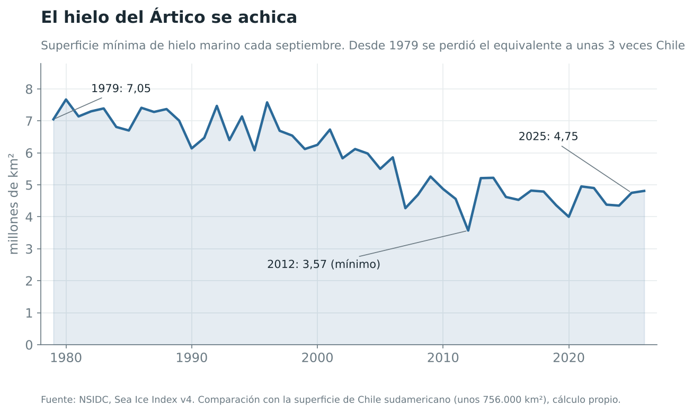

El hielo del mar Ártico llega a su mínimo cada septiembre, al final del verano del hemisferio norte. En 1979, primer año del registro satelital, ese mínimo fue de 7,05 millones de km². En 2025 fue de 4,75 millones. La diferencia, 2,3 millones de km², equivale a unas tres veces la superficie de Chile sudamericano (cálculo propio). El IPCC atribuye principalmente a la influencia humana esta pérdida, que fue de cerca del 40% en septiembre al comparar 1979–1988 con 2010–2019.

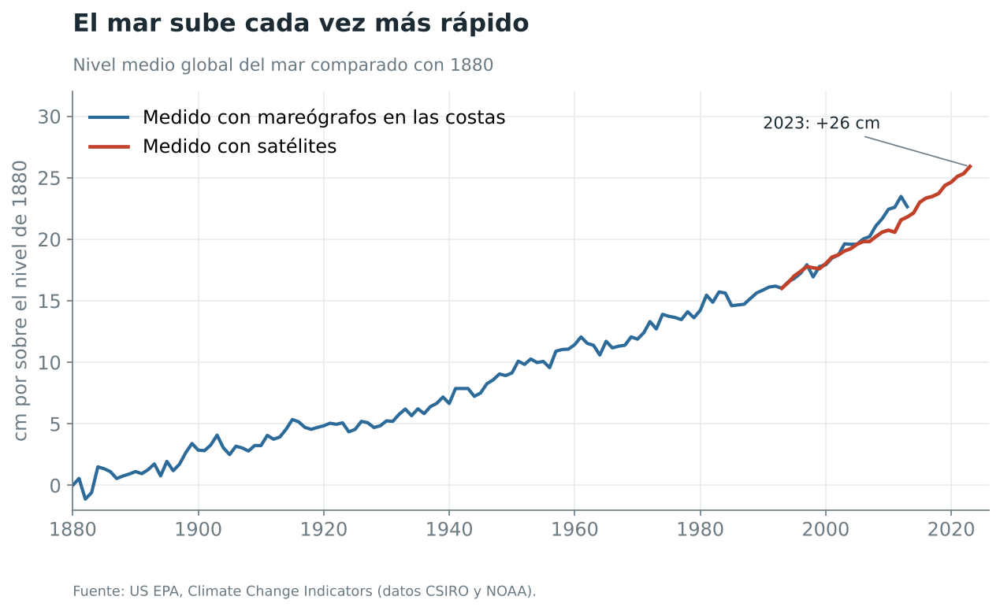

El nivel del mar subió unos 20 cm entre 1901 y 2018, y cada vez sube más rápido. Entre 1901 y 1971 subía 1,3 mm al año, y entre 2006 y 2018 subió 3,7 mm al año. Según la NASA, desde 1993, cuando empezaron las mediciones con satélites, el mar ha subido unos 10 cm y la velocidad de subida se ha más que duplicado.

> **¿Por qué sube el mar?** Por dos razones. El agua se expande cuando se calienta, igual que el aire de un globo al sol, y el hielo que estaba sobre tierra firme, en glaciares y en Groenlandia o la Antártida, se derrite y escurre al océano. El hielo que ya flota en el mar, como el del Ártico, casi no cambia el nivel al derretirse.

El océano es donde se acumula la mayor parte del calor extra. Solo en 2025, los 2.000 metros superiores del océano ganaron 23 zettajoules de energía, un nuevo récord. Para dimensionarlo, equivale a unos 37 años de toda la energía primaria que consume la humanidad, a niveles de 2023.

> **¿Qué es un zettajoule?** Un joule es una unidad de energía. Un zettajoule es un uno seguido de 21 ceros de joules.

**Datos clave.** Pérdida de hielo ártico de septiembre equivalente a tres Chiles. Unos 20 cm de subida del mar desde 1901. Calor ganado por el océano en 2025 equivalente a 37 años de energía mundial.

**Guion visual.**

Esta sección funciona como tres pantallas cortas, una por señal, cada una con su ícono. Un bloque de hielo, una ola sobre una regla y un termómetro sumergido.

Para el hielo se sugiere una silueta simple del océano Ártico vista desde arriba, con la mancha blanca del hielo que se achica al hacer scroll entre 1979 y 2025. Al lado aparece la silueta de Chile repetida tres veces, para que el lector vea el tamaño de lo perdido.

Para el mar, el gráfico se dibuja primero con la línea azul de los mareógrafos y después aparece encima la línea roja de los satélites, con la tarjeta "Dos métodos distintos, la misma curva".

Para el océano, una barra de "energía" que se llena junto a 37 pequeños íconos de enchufe o ampolleta, uno por año de consumo mundial.

**Fuentes.** NSIDC, Sea Ice Index v4. US EPA, indicadores de nivel del mar (datos CSIRO y NOAA). NASA JPL (2025). Pan et al. (2026), *Advances in Atmospheric Sciences*. IPCC AR6 GTI, A.1.5 y A.1.7.

---

# 8. Los argumentos que más circulan

**Bajada.** Lo que se dice, y lo que muestran los estudios.

**"Los científicos no se ponen de acuerdo."**
En 2021, Mark Lynas y sus colegas revisaron 88.125 estudios sobre clima publicados entre 2012 y 2020. El acuerdo sobre el origen humano del calentamiento supera el 99%. En una muestra al azar de 3.000 artículos, encontraron solo 4 escépticos.

> **¿Qué es la revisión por pares?** Antes de publicarse en una revista científica, un estudio es revisado por otros especialistas que no participaron en él. Ellos buscan errores y pueden pedir cambios o rechazarlo. No garantiza que un estudio sea perfecto, pero filtra muchos errores.

**"En los años setenta los científicos anunciaban una glaciación."**
Thomas Peterson y sus colegas revisaron en 2008 la literatura científica publicada entre 1965 y 1979. De 71 artículos, solo 7 anticipaban enfriamiento, mientras que 44 anticipaban calentamiento por el aumento del CO₂. La idea de una glaciación inminente vino sobre todo de la prensa.

**"Los modelos climáticos siempre se equivocan."**
En 2020, Zeke Hausfather y su equipo compararon modelos publicados entre 1970 y 2007 con lo que realmente pasó después. La mayoría proyectó un calentamiento coherente con el observado, en especial al corregir las diferencias entre las emisiones que esos modelos supusieron y las que de verdad ocurrieron.

> **¿Qué es un modelo climático?** Es una representación del sistema climático, generalmente en computador, construida a partir de las leyes de la física, la química y la biología. Permite estimar cómo responderá el clima a distintos escenarios, por ejemplo a más o menos emisiones.
>
> *Adaptado del Glosario del IPCC.*

**"Los volcanes emiten más CO₂ que nosotros."**
Los volcanes emiten entre 0,3 y 0,6 mil millones de toneladas de CO₂ al año. La humanidad emite más de 60 veces esa cantidad.

**"El CO₂ es apenas una mínima parte del aire."**
Es cierto. Son unas 4 partículas de cada 10.000. Pero su capacidad de absorber calor se mide en laboratorio desde 1859, y el enfriamiento de la estratosfera confirma que ese efecto está ocurriendo. Una sustancia muy activa puede tener un gran efecto en poca cantidad.

**"Este invierno hizo un frío terrible."**
El tiempo es lo que pasa un día en un lugar. El clima es el promedio de décadas en todo el planeta. Un invierno frío en una ciudad es compatible con un planeta que se calienta, igual que un mal día en la bolsa no desmiente una tendencia de largo plazo.

**"Es un ciclo natural del Sol."**
La energía del Sol no ha aumentado desde mediados del siglo XX, y la estratosfera se está enfriando, algo que un Sol más activo no provocaría. El IPCC estima el efecto natural total entre −0,1 y +0,1 °C.

**"Un grado más no le hace daño a nadie."**
Un grado de promedio esconde cambios mayores. Según el IPCC, entre 1850–1900 y 2011–2020 la tierra firme se calentó 1,59 °C, casi el doble que el océano, que se calentó 0,88 °C. Y ese calor extra ya se nota en menos hielo, más mar y un océano que acumula energía año tras año.

**Guion visual.**

Cada mito es una tarjeta que se da vuelta al tocarla, igual que una carta. En el frente va la frase del mito, entre comillas grandes, con un ícono pequeño. Al reverso va la respuesta, con el dato principal destacado en rojo y la fuente abajo. Las tarjetas se ordenan en una grilla de dos columnas en computador y de una columna en celular.

Íconos sugeridos por tarjeta. Una pila de documentos para el consenso, una portada de diario antiguo para la glaciación de los setenta, una pantalla con una curva para los modelos, un volcán para los volcanes, una gota pequeña dentro de un frasco para el CO₂ escaso, un copo de nieve para el invierno frío, un sol para el ciclo solar y un termómetro con "+1" para el grado de más.

**Fuentes.** Lynas, Houlton y Perry (2021), *Environmental Research Letters*. Peterson, Connolley y Fleck (2008), *Bulletin of the American Meteorological Society*. Hausfather et al. (2020), *Geophysical Research Letters*. NOAA Climate.gov. Santer et al. (2023). IPCC AR6 GTI, A.1.2 y A.1.3. Glosario del IPCC AR6.

---

# 9. ¿Y qué tiene que ver con Chile?

**Bajada.** La megasequía también lleva una parte de huella humana.

**Texto.**

Chile conoce de cerca un efecto concreto. Desde 2010, la zona central vive una megasequía, con años que han tenido entre 25% y 45% menos lluvia que lo normal, según el estudio de René Garreaud y colegas publicado en 2017.

Una parte de esa sequía se explica por la variabilidad natural del océano Pacífico. Sin embargo, un estudio de Juan Pablo Boisier, Roberto Rondanelli, René Garreaud y Francisca Muñoz, publicado en 2016, estimó que cerca de un cuarto del déficit de lluvia tiene origen humano.

Al mismo tiempo, Chile aporta alrededor del 0,2% de las emisiones fósiles mundiales de CO₂. En 2024 emitió unas 4,0 toneladas por habitante, por debajo del promedio mundial de 4,7. Por ello, el país enfrenta una doble tarea. Debe reducir sus propias emisiones y, sobre todo, adaptarse a impactos que dependen de lo que haga el resto del mundo.

> **¿Qué es la atribución?** Es la rama de la ciencia del clima que estima cuánto de un cambio observado, como una sequía o una ola de calor, se debe a causas humanas y cuánto a la variabilidad natural. Se hace comparando simulaciones del clima con y sin el efecto humano.

**Datos clave.** Entre 25% y 45% menos lluvia al año en Chile central desde 2010. Cerca de un cuarto de ese déficit atribuido a la influencia humana. 0,2% de las emisiones fósiles mundiales.

**Guion visual.**

Una silueta vertical de Chile, con la zona central destacada en color tierra. Al hacer scroll, sobre la zona central caen gotas que van disminuyendo. Luego aparece un pictograma de 100 gotas en el que entre 25 y 45 quedan vacías (el déficit). Dentro de las gotas vacías, una de cada cuatro se marca en rojo, para representar la parte atribuida a la acción humana.

Al final, una comparación muy simple de dos íconos de persona. Uno representa a un habitante promedio de Chile con 4,0 toneladas de CO₂ al año y el otro al promedio mundial con 4,7.

**Fuentes.** Garreaud et al. (2017), *Hydrology and Earth System Sciences*. Boisier et al. (2016), *Geophysical Research Letters*. Our World in Data, base de datos de CO₂.

**Nota para el desarrollo.** Esta sección puede crecer con datos de la Dirección Meteorológica de Chile o del Centro de Ciencia del Clima y la Resiliencia (CR)2 sobre temperatura y glaciares. No se incluyeron porque no fueron verificados en esta revisión.

---

# 10. Cierre

**Bajada.** Si llegaste hasta acá, esto es lo que sabemos.

**Texto.**

El clima siempre ha cambiado, y por eso sabemos que lo de ahora es distinto. El CO₂ está muy por encima de todo lo registrado en 800.000 años, y el planeta se calienta decenas de veces más rápido que al salir de la última glaciación. Ese CO₂ lleva la firma química de los combustibles fósiles, y ni el Sol ni los volcanes explican lo que se observa. El hielo, el mar y el océano confirman lo que dicen los termómetros.

> **¿Qué es el cambio climático?** El IPCC lo define como un cambio en el estado del clima que se puede identificar en su promedio o en su variabilidad y que persiste por un periodo largo, típicamente décadas o más. Puede tener causas naturales o humanas. La Convención Marco de Naciones Unidas sobre el Cambio Climático usa el término para referirse específicamente al cambio atribuido a la actividad humana, que se suma a la variabilidad natural.
>
> *Adaptado del Glosario del IPCC.*

Por ello, la discusión científica ya dejó de girar en torno a si el cambio climático existe. Hoy la pregunta es cuánto y qué tan rápido podemos frenarlo. El Global Carbon Project estima que, para limitar el calentamiento a 1,5 °C, quedan unas 170 mil millones de toneladas de CO₂ por emitir, lo que equivale a unos cuatro años al ritmo de 2025.

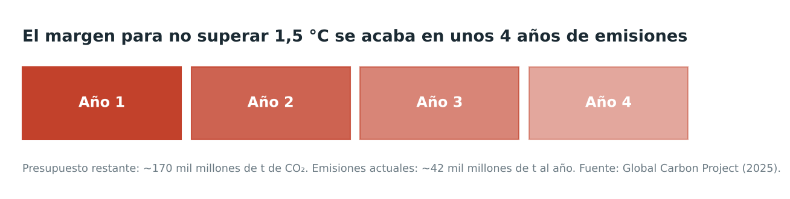

El informe Indicators of Global Climate Change estima que el calentamiento causado por el ser humano llegó a 1,37 °C en 2025 y avanza a 0,27 °C por década.

Cada décima de grado que se evite reduce los impactos. Si después de leer esto todavía tienes dudas, perfecto. Las fuentes están todas abajo y son públicas. Revísalas.

**Guion visual.**

El cierre retoma la portada. Las franjas de calentamiento vuelven a aparecer, ahora a pantalla completa, y a su derecha queda un espacio en blanco con un signo de interrogación, para indicar que los próximos años todavía no están escritos.

El presupuesto de carbono se muestra como cuatro bloques rojos (cuatro años) que se van vaciando uno por uno al hacer scroll, como un reloj de arena horizontal.

**Fuentes.** Global Carbon Project (2025). Forster et al. (2026), *Earth System Science Data*. Glosario del IPCC AR6.

---

# Glosario rápido

**Anomalía.** Diferencia entre un valor y el promedio de un periodo de referencia.

**Atribución.** Estimación de cuánto de un cambio se debe a causas humanas y cuánto a causas naturales.

**Cambio climático.** Cambio del clima que persiste por décadas o más, sea por causas naturales o humanas. En el lenguaje de Naciones Unidas, se refiere al cambio atribuido a la actividad humana.

**Clima.** Tiempo promedio de un lugar durante un periodo largo, clásicamente 30 años.

**Efecto invernadero.** Retención de calor en la atmósfera por gases que absorben la radiación infrarroja que emite la Tierra.

**El Niño y La Niña.** Fases de un fenómeno natural del Pacífico tropical que calientan o enfrían temporalmente el planeta.

**Estratosfera.** Capa de la atmósfera sobre la troposfera, que llega hasta unos 50 km de altura.

**Glaciación.** Periodo frío con grandes capas de hielo sobre los continentes y un nivel del mar más bajo.

**IPCC.** Grupo Intergubernamental de Expertos sobre el Cambio Climático, creado en 1988 por Naciones Unidas y la OMM.

**Irradiancia solar.** Energía del Sol que llega a la parte alta de la atmósfera, en W/m².

**Isótopo.** Variante de un elemento químico con distinto peso. Permite rastrear el origen del carbono.

**Modelo climático.** Representación del sistema climático basada en leyes físicas, químicas y biológicas.

**Núcleo de hielo.** Cilindro de hielo extraído de un glaciar o capa de hielo para estudiar el clima del pasado.

**Nivel preindustrial.** Periodo previo a la industrialización masiva, hacia 1750. Para la temperatura se usa 1850–1900 como referencia.

**ppm.** Partes por millón. 427 ppm de CO₂ significa 427 moléculas de CO₂ por cada millón de moléculas de aire.

**Revisión por pares.** Revisión de un estudio por especialistas independientes antes de su publicación.

**Tiempo (meteorológico).** Estado de la atmósfera en un momento y lugar determinados.

**Troposfera.** Capa más baja de la atmósfera, donde están las nubes y ocurre el tiempo.

**Zettajoule.** Unidad de energía equivalente a 10²¹ joules.

---

# Fuentes completas

1. NOAA NCEI. Climate at a Glance, Global Time Series. https://www.ncei.noaa.gov/access/monitoring/climate-at-a-glance/global/time-series
2. Copernicus C3S (2026). Global Climate Highlights 2025. https://climate.copernicus.eu/copernicus-2025-was-third-hottest-year-record
3. Copernicus C3S. Boletín de septiembre de 2026. https://climate.copernicus.eu/copernicus-second-warmest-september-global-temperatures-stay-above-15degc
4. NOAA GML y Scripps. Trends in Atmospheric Carbon Dioxide, Mauna Loa. https://gml.noaa.gov/ccgg/trends/
5. Met Office. Mauna Loa carbon dioxide forecast for 2025. https://www.metoffice.gov.uk/research/climate/seasonal-to-decadal/long-range/forecasts/co2-forecast-for-2025
6. IPCC (2021). AR6 Grupo de Trabajo I, Resumen para responsables de políticas. https://www.ipcc.ch/report/ar6/wg1/chapter/summary-for-policymakers/
7. IPCC (2021). AR6 Grupo de Trabajo I, Anexo VII, Glosario. https://www.ipcc.ch/report/ar6/wg1/downloads/report/IPCC_AR6_WGI_AnnexVII.pdf
8. Bereiter, B. et al. (2015). Registro revisado de CO₂ de 800.000 años en núcleos de hielo antártico. NOAA Paleoclimatología. https://www.ncei.noaa.gov/pub/data/paleo/icecore/antarctica/antarctica2015co2composite.txt
9. Tierney, J. E. et al. (2020). Glacial cooling and climate sensitivity revisited. *Nature*. https://doi.org/10.1038/s41586-020-2617-x
10. Osman, M. B. et al. (2021). Globally resolved surface temperatures since the Last Glacial Maximum. *Nature* 599, 239–244. https://experts.arizona.edu/en/publications/globally-resolved-surface-temperatures-since-the-last-glacial-max/
11. Global Carbon Project (2025). Fossil fuel CO₂ emissions hit record high in 2025. https://globalcarbonbudget.org/fossil-fuel-co2-emissions-hit-record-high-in-2025/
12. Our World in Data. CO₂ and Greenhouse Gas Emissions dataset. https://github.com/owid/co2-data
13. Graven, H. et al. (2020). Changes to carbon isotopes in atmospheric CO₂ over the industrial era and into the future. *Global Biogeochemical Cycles*. https://doi.org/10.1029/2019GB006170
14. NOAA Climate.gov. Which emits more carbon dioxide, volcanoes or human activities? https://www.climate.gov/news-features/climate-qa/which-emits-more-carbon-dioxide-volcanoes-or-human-activities
15. LASP, Universidad de Colorado. Historical Total Solar Irradiance Reconstruction. https://lasp.colorado.edu/lisird/latis/dap/historical_tsi.csv
16. Santer, B. D. et al. (2023). Exceptional stratospheric contribution to human fingerprints on atmospheric temperature. *PNAS*. https://externalaffairs.ucla.edu/news/stratospheric-cooling-the-concerning-flip-side-of-global-warming/
17. Weart, S. The Discovery of Global Warming. American Institute of Physics. https://history.aip.org/climate/index.htm
18. NSIDC. Sea Ice Index, versión 4. https://nsidc.org/data/g02135
19. US EPA. Climate Change Indicators, Sea Level. https://www.epa.gov/climate-indicators/climate-change-indicators-sea-level
20. NASA JPL (2025). NASA analysis shows unexpected amount of sea level rise in 2024. https://www.jpl.nasa.gov/news/nasa-analysis-shows-unexpected-amount-of-sea-level-rise-in-2024/
21. Pan, Y. Y. et al. (2026). Ocean Heat Content Sets Another Record in 2025. *Advances in Atmospheric Sciences*. https://doi.org/10.1007/s00376-026-5876-0
22. Lynas, M., Houlton, B. Z. y Perry, S. (2021). Greater than 99% consensus on human caused climate change in the peer-reviewed scientific literature. *Environmental Research Letters* 16, 114005. https://news.cornell.edu/stories/2021/10/more-999-studies-agree-humans-caused-climate-change
23. Peterson, T. C., Connolley, W. M. y Fleck, J. (2008). The myth of the 1970s global cooling scientific consensus. *BAMS*. https://nora.nerc.ac.uk/id/eprint/11584
24. Hausfather, Z. et al. (2020). Evaluating the performance of past climate model projections. *Geophysical Research Letters*. https://www.giss.nasa.gov/pubs/abs/ha08910q.html
25. Garreaud, R. D. et al. (2017). The 2010–2015 megadrought in central Chile. *Hydrology and Earth System Sciences* 21. https://hess.copernicus.org/articles/21/6307/2017/
26. Boisier, J. P., Rondanelli, R., Garreaud, R. D. y Muñoz, F. (2016). Anthropogenic and natural contributions to the Southeast Pacific precipitation decline and recent megadrought in central Chile. *Geophysical Research Letters*. https://www.cr2.cl/wp-content/uploads/2016/05/Anthropogenic-and-natural-contributions.pdf
27. Forster, P. M. et al. (2026). Indicators of Global Climate Change 2025. *Earth System Science Data* 18, 3889–3933. https://essd.copernicus.org/articles/18/3889/2026/index.html

---

# Notas para Claude Code

La web de referencia es https://natalidad-chile.netlify.app/. La propuesta es seguir su lógica narrativa y no copiar sus ilustraciones. Todos los íconos y dibujos deben ser propios, en línea simple y con la paleta de dos colores descrita en "Sistema visual general".

Los gráficos de la carpeta `graficos/` son de referencia. Para la web conviene rehacerlos con una librería que permita animarlos al hacer scroll, usando los CSV de la carpeta `datos/`, que contienen exactamente las series empleadas. Las franjas de la portada y el gráfico de temperatura salen del mismo archivo, `04_temperatura_global_noaa.csv`, lo que permite la transición de franjas a barras descrita en la sección 2.

Los pictogramas (reloj, 10.000 partículas, volcanes y humanos, presupuesto de carbono) se construyen con pocos valores que están escritos en este documento y no necesitan CSV propio.

Los recuadros de definición marcados con `>` deben verse distintos del texto principal. Se sugiere un fondo suave y un borde lateral azul.

Si los textos se acortan, conviene mantener cada cifra junto a su fuente.
